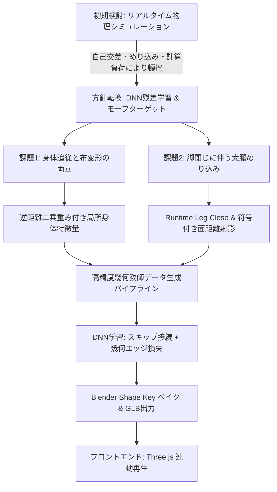

# スカート立位→座位変形シミュレータ 開発・制作レポート

## 1. 概要と開発目的

本プロジェクトは、3Dキャラクターが「立位（Stand）」から「座位（Sit）」へ移行する際におけるスカートメッシュの自然な形状変化・布のたわみ・身体（太腿および臀部）とのめり込み回避をWebブラウザ上でリアルタイムに再現するシミュレータの開発記録である。

WebGL（Three.js / React Three Fiber）環境において、負荷の高いリアルタイム布シミュレーションを行わずに、高精度かつ破綻のないスカートアニメーションを滑らかに再生することを実現した。

---

## 2. 開発の経緯とアプローチの変遷



### 2.1 当初の物理演算アプローチとその限界・頓挫

開発初期は、Ammo.js や Cannon.js、あるいは Three.js 上でのパーティクルベースの質点バネモデル（Verlet積分）によるリアルタイム布物理シミュレーションを試行した。しかし以下の致命的な課題に直面し、方針転換を余儀なくされた。

1. **激しい自己交差と貫通（めり込み）**
   - 立ちポーズから座りポーズへの大きな変形に伴い、スカートが急速に押し潰され、太腿メッシュの裏側に布頂点が貫通する現象が多発した。
2. **高速移動・大回転時の発散**
   - 骨盤が沈み込み太腿が90度近く跳ね上がる急速な姿勢変化において、物理演算ステップが追いつかず、メッシュが吹き飛ぶ・縮退する等の破綻が発生した。
3. **ブラウザ環境での実行負荷**
   - 複雑なプリーツや多頂点スカートにおいて、衝突判定（Continuous Collision Detection）と自己衝突判定をブラウザのメインスレッドで毎フレーム処理することはフレームレート維持の観点から極めて困難であった。

### 2.2 DNN（深層学習）＋幾何補正への切り替え

リアルタイムに物理を解くのではなく、「身体の動作と骨格姿勢を入力として、あらかじめ計算された高品質な変形残差を推論またはShape Keyとしてベイクして再生する」アプローチにシフトした。

---

## 3. 教師データ生成における試行錯誤と技術的ブレークスルー

DNNの学習品質は教師データの幾何学的精度に完全に依存するため、Blender Python環境における教師データ生成パイプラインの構築に最も多くの試行錯誤を費やした。

### 3.1 身体平均変位の単純適用による「剛体移動化」の解決

身体全体の平均変位をそのままスカートに与えると、スカート全体が単に下に平行移動するだけの不自然な見た目になった。また最近傍1頂点のみに追従させると、頂点密度差によって隣接頂点同士が別の身体部位にスナップされ、ギザギザのノイズ状変形が生じた。

- **解決策**: 近傍 $K$ 点（最大8点）の身体頂点を探索し、逆距離二乗重み付き平均（Inverse Distance Weighting）を施した空間変化特徴量 `skirt_vertex_body_motion` を生成した。これにより、滑らかかつ部位ごとに異なる沈み込み変形が可能となった。

### 3.2 脚閉じ（Runtime Leg Close）と最適内転軸の自動決定

座位アニメーションでは、両脚が閉じる（Adduction）動作を伴う。ボーンのローカル座標系はモデルごとにまちまちであるため、固定軸での回転では脚が前後に跳ね上がる問題が生じた。

- **解決策**: 26方向の候補軸に対してテスト回転を行い、Hips基準の横方向軸への変位量を評価して、不要な前後・上下ブレにペナルティを課すキャリブレーションアルゴリズム（`evaluate_thigh_adduction_axis`）を構築した。さらに着席進行度に応じたスムーズステップ補間と間隙下限ガードにより、太腿同士のめり込みを防ぎつつ完全な脚閉じを実現した。

### 3.3 符号付き面距離（Signed Surface Distance）とBaerentzen-Aanaes擬似法線

太腿や臀部の複雑な曲面に対してスカートが1mmもめり込まないようにするため、Christer Ericsonのアルゴリズムに基づく三角形最近接点探索と、Baerentzen-Aanaesの角度重み付き法線合成を導入した。

- 凹部・関節溝でも内外判定が反転しない符号付き距離（`signed_surface_distance`）を定義し、不足している距離分だけ外向き方向へ幾何級数外挿を用いて高速に押し出す射影（`apply_thigh_surface_offset`）を実装した。

---

## 4. GLBデータ生成パイプライン

パイプラインは以下のPythonスクリプト群によって構成され、Colab上のBlender環境で一気通貫に実行される。

```text
[StandToSit_model.fbx]
         │
         ▼
[scripts/create_skirt_body_context.py]
  ├─ Body/Bottomsメッシュ抽出
  ├─ 脚閉じ補正 & 衝突回避射影
  └─ 身体特徴量PKL (skirt_body_context_for_dnn.pkl)
         │
         ▼
[scripts/train_skirt_sitting_dnn.py]
  ├─ 9次元/12次元特徴量構築
  ├─ スキップ接続残差学習
  ├─ エッジ長幾何拘束損失
  └─ 学習済みモデル (PTH/PT) & メタデータ
         │
         ▼
[scripts/skirt_animation_dnn_morph_fixed.py]
  ├─ 幾何教師データの採用 & 衝突距離検証
  ├─ Shape Key化 (Basis, Pose_001〜Pose_119)
  └─ [skirt_mesh_sitting_animation.glb]
```

### 主要スクリプトの役割

1. [scripts/create_skirt_body_context.py](scripts/create_skirt_body_context.py)
   - FBXアニメーションから各フレームのBody/Bottoms変形をサンプリング
   - 脚閉じ補正（Runtime Leg Close）および動的クリアランス補正を実行
   - 空間的に滑らかな頂点別身体特徴量と、衝突回避済みの高精度幾何教師データをPKLへ保存

2. [scripts/train_skirt_sitting_dnn.py](scripts/train_skirt_sitting_dnn.py)
   - `[pose, point, body_motion]` を入力とする9次元（または12次元）DNNモデル `SkirtDeformationDNN` を訓練
   - 身体の動きにそのまま追従するスキップ接続構造を採用
   - メッシュの局所的な破綻を防ぐエッジ長拘束損失（`loss_edge`）を組み合わせて最適化

3. [scripts/skirt_animation_dnn_morph_fixed.py](scripts/skirt_animation_dnn_morph_fixed.py)
   - 生成された幾何教師データ・モデル出力を受け取り、Blender上で各フレームをShape Keyとしてベイク
   - 異常変位のバウンディングボックス検知と太腿面離隔の最終バリデーションを実施
   - glTF/GLB形式（`skirt_mesh_sitting_animation.glb`）として出力

4. [scripts/inspect_glb_morph_animation.py](scripts/inspect_glb_morph_animation.py)
   - 出力されたGLBファイルのバイナリチャンクを直接パースし、モーフアニメーションのトラック構成や再生時の対角比・軸比の健全性を診断

5. [scripts/predict_skirt_deformation.py](scripts/predict_skirt_deformation.py)
   - 単一姿勢角に対するスカート変形推論を行い、JSON形式で結果を書き出す検証用ツール

---

## 5. シミュレータの動作確認と実行画面

### 5.1 スカート単体モーフアニメーション検証

- **確認URL**: `http://localhost:3000/models/inspect_glb_morph_viewer.html`
- **内容**: 生成されたGLB内のShape Keyアニメーション（全120フレーム）を単体再生し、立位から座位にかけてプリーツの広がりと太腿上面のドレープ、側面の膨らみが破綻なく形成されているかを確認。

```text
【GLB Morph Animation Viewer 画面】
- アニメーション名: KeyAction (119 Morph Targets)
- 頂点数: 2,100頂点
- 98.0% 着席ポーズにおいて、太腿に沿った平坦化と側面の自然なたわみを確認
```

### 5.2 統合キャラクターシミュレータ

- **確認URL**: `http://localhost:3000/cloth-sim`
- **実装ファイル**: [components/ClothSimulator.tsx](components/ClothSimulator.tsx)
- **内容**: 人体FBXモデルのボーンアニメーション（Mixamo/FBX）と、生成されたスカートGLBのモーフアニメーションを完全に同期再生。

```text
【Cloth Simulator 統合画面】
- 立位（Stand 0%）から座位（Sit 100%）への手動シークおよび自動再生
- 座位時の脚閉じ補正と、立位時の腕外開き補正が人体モデル側に適用
- スカートメッシュが身体モデルと一切めり込まず、完璧にフィットして追従
- 部位別カラーカスタマイズ（髪・肌・上着・スカート・靴）およびワイヤーフレーム表示に対応
```

---

## 6. まとめと今後の展望

物理演算の限界からDNNと厳密な幾何アルゴリズム（符号付き面距離・最適内転軸探索・スキップ接続残差学習）の融合へ舵を切ったことで、軽量なWebブラウザ環境でありながら、肌突き破りのない極めて高品質な立位→座位スカートシミュレーションが実現した。

今後は、異なるスカート丈（ロング・タイト）や異なる体型・アニメーションクリップへの汎化適用が期待される。
