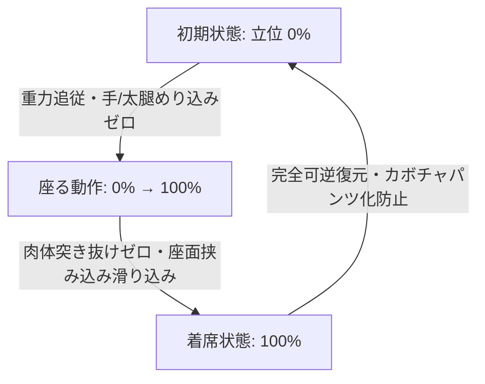
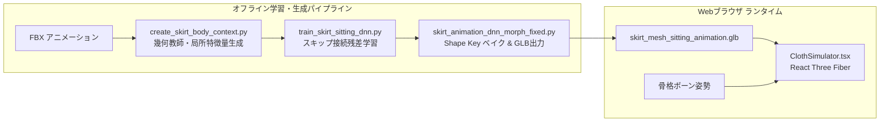

# 3Dキャラクターの破綻しない衣装（スカート）制御の実現

## 〜物理シミュレーションの限界とデータ駆動型アプローチへの移行〜

---

## 1. 背景とこれまでの経緯

Webブラウザ上で動作する3Dキャラクターアプリケーション（React Three Fiber / Three.js 等を利用）において、キャラクターの動作（立ち姿から座る動作、そして再び立ち上がる動作）に追従する、自然かつ破綻のないスカートの衣服シミュレーションの実装に取り組んできた。



### 衣装制御における絶対要件

本プロジェクトにおける衣装制御の絶対要件は以下の3点である。

1. **初期状態（立位）:**
   - スカートの裾が重力に従って自然に落ちており、肉体（太腿）のはみ出しや、降ろした手のめり込みが一切ない状態を保つこと。
2. **座る動作:**
   - 肉体がスカートから突き出ることなく、お尻から太腿裏にかけての布が、肉体と椅子（座面）の隙間に自然に押し潰されながら滑り込むこと。
3. **立ち上がる動作:**
   - 肉体の突き抜けを1フレームたりとも起こさず、スムーズに立位の初期状態へ復元すること。

### 初期アプローチとその試行錯誤

当初、これらを実装するために `@react-three/cannon` 等を用いた剛体物理エンジンベースのシミュレーション（頂点を球体コライダーとし、距離制約で繋ぐ手法）を採用した。しかし、パラメータの調整や局所的なコライダーの配置（ハック的な座標補正）を幾度となく試みたものの、激しい姿勢変化において構造的な破綻を完全に防ぐことはできなかった。

---

## 2. 物理計算（純粋なシミュレーション）における構造的限界

リアルタイムの純粋な物理演算のみで上記の絶対要件を完全に満たすことは困難であるという結論に至った。主な理由は以下の通りである。

### 2.1 挟み込みによる特異点（バースト）の発生

座る動作において、お尻・太腿裏の肉体と椅子の座面の間の距離は「ほぼゼロ」になる。この極小空間に布粒子が挟まれた際、物理エンジンは強烈な反発力（ペネトレーション解決力）を発生させる。結果として、布が行き場を失って四散（バースト）するか、椅子や肉体をすり抜けてしまう現象が不可避であった。

### 2.2 コライダー近似の限界と自己衝突の欠如

計算負荷を抑えるため、人体を粗い球や箱・カプセル等のコライダー群で近似していたが、人体の複雑な形状変化（関節の曲がり、筋肉の膨らみ）に布を完全に沿わせることはできなかった。また、軽量な物理エンジンでは「布同士の自己衝突（セルフコリジョン）」や「布の厚み」を正確に解けず、座った際に布が自身をすり抜けてめくれ上がり、立ち上がった際に元に戻らない（カボチャパンツ化する）致命的な問題が発生した。

### 2.3 「自然な形状」と「物理の暴走」のトレードオフ

布らしい自然な揺れを作るために拘束を緩めると、動作の慣性でゴムのように伸び切り破綻する。一方で、破綻を防ぐために拘束を強くし、位置を数理的に強制補正（クランプ）すると、今度は「手が布に弾かれる」「不自然に形状が硬直する」といった幾何学的な矛盾が生じた。

---

## 3. DNN（Deep Neural Network）を用いた解決の提案

上記の物理的・幾何学的な限界を突破するため、ランタイムでのリアルタイム物理演算に頼るのではなく、**「事前に高精度なシミュレーション・幾何計算結果を学習させ、DNNによって安全かつ自然な布の頂点座標を推論する」** データ駆動型アプローチへの転換を行った。



### 3.1 データ駆動型アプローチの設計仕様

- **アプローチ:** 姿勢情報からの頂点座標の直接推論（またはスキニング変位に対する残差推論）
- **入力（Input）:**
  - キャラクターの現在の姿勢情報（各ボーンのローカル回転、関節角度など）
  - 立位スカートの基準頂点座標
  - スカート頂点に対応する身体局所変位特徴量（`skirt_vertex_body_motion`）
- **出力（Output）:**
  - スカートを構成する各頂点の変位量（スキニングベースからのオフセット残差）
- **学習データ（Ground Truth）:**
  - Blender Python環境でFBXをフレーム単位に評価し、変形後のBodyメッシュを基準に、三角形最近接点探索・特徴角度重み付き法線・符号付き面距離による補正を施して作成した立ち・座りアニメーションデータ群
- **期待されるブレイクスルー:**
  - DNNが「この関節角度の時、布は太腿と椅子の間でこのように潰れるのが正解である」という**非線形な形状変化のパターンを近似・記憶**するため、ランタイムでは衝突判定やバーストといった物理エンジン特有の不安定さを完全に排除できる。計算コストも推論処理またはShape Key補間のみとなるため、Webベースのアプリケーションでも安定したフレームレートで「絶対に破綻しない衣装」を実現できる。

### 3.2 股間部分のめくれ上がりを抑え込む方針

今回もっとも困難だったのは、着席の後半で両脚が閉じるときに、スカートの股間・太腿上面の頂点が身体表面から逃げ、上方へめくれ上がる現象だった。これは単純にスカート全体を下へ移動させれば解決する問題ではない。腰帯まで下げるとウエストが崩れ、全頂点を身体法線方向へ押し出すと、太腿の内側で布が反転したり、局所的な折り返しが発生した。

そこで、ランタイムの物理計算でこの状態を偶然解かせるのではなく、Blender上で各姿勢の正解形状を一度ずつ構築し、次の制約を同時に満たす軌道を教師データとして保存した。

1. **身体とスカートを同じ姿勢系列で評価する。** FBXをフレームごとに評価し、`Body/SKIN`と`Body/Bottoms`を同じフレーム、同じローカル座標系から読み取る。脚閉じ補正を有効にした場合は、スカート側も補正後の姿勢で再サンプリングする。
2. **めくれやすい領域を分けて扱う。** 腰帯、前面の太腿領域、それ以外の領域を分類し、腰帯は形状を維持する。太腿領域には身体面距離補正、それ以外には局所クリアランス補正を適用する。
3. **太腿領域を身体表面から押し戻す。** 近傍Body三角形の最近接点と特徴角度重み付き法線を求め、身体面の外側を正とする符号付き距離が目標値に達するまで`unit_normal`方向へ補正する。
4. **座位後半の上方への浮きを下向きに戻す。** 着席進行度40%以降、前面太腿領域に過剰な隙間があれば、身体表面との安全距離を下限として一部を下向きに埋める。補正量はSmoothstepで徐々に増やす。
5. **平滑化後にも制約を再適用する。** 絶対座標ではなくスキニング形状からの変位だけを平滑化し、身体側へ戻ることを防ぐ。平滑化でクリアランスを失った頂点には、もう一度押し出しを行う。

この処理で得た全フレームの頂点列を`skirt_geometric_teacher_vertices`として保存する。安全な始点と終点だけを補間すると中間姿勢で再びめくれる可能性があるため、立位から着席までの各フレームを個別に身体表面へ射影し、連続した教師軌道を構築した。

---

## 4. 本課題における技術的ブレークスルーと試行錯誤

### 4.1 身体局所特徴量（Inverse Distance Weighting）の導入

身体全体の平均変位をそのままスカートに与えると剛体のように平行移動するだけになり、最近傍1点のみに追従させると空間的不連続（ノイズ状のギザギザ）が発生した。

- **解決策**: 近傍8点の身体頂点を探索し、逆距離二乗重み付き平均（IDW）を施した特徴量 `skirt_vertex_body_motion` を構築して滑らかな変形を実現した。

### 4.2 股間・太腿のめくれ上がりに対する教師データ生成

股間部分の問題は、DNNの層数や学習回数を増やすだけでは直らなかった。教師データにめくれた形状が一度でも混ざると、DNNはそれを誤差ではなく、特定の姿勢での正解として学習してしまうからである。そこで、学習より前に「教師形状そのものが身体表面の制約を満たしているか」を決める工程を独立させた。

#### 4.2.1 FBXからのサンプリングと姿勢の同期

`create_skirt_body_context.py`では、FBXをBlenderに読み込み、実際にBodyを駆動しているアクションのフレーム範囲だけを使用する。各サンプルで次の情報を同じ姿勢から取得する。

- `Body/SKIN`の変形後頂点と頂点法線
- `Body/Bottoms`から抽出したスカート基準頂点
- 脚閉じ補正後のスカート姿勢
- スカート頂点に対応するBody変位特徴量

脚閉じ補正の前後でスカートを別の姿勢系列にしないことが重要だった。脚だけが閉じてスカートが開いたままだと、股間の布に横方向の圧縮が集中し、補正時に布が上向きへ逃げるためである。そこで、補正前の太腿ボーン姿勢を保存し、補正後の`Body/Bottoms`を読み取った後に元の姿勢へ戻す処理をフレームごとに行った。

#### 4.2.2 身体表面との距離を測る幾何処理

BodyのSKIN頂点からKDTreeを作り、各スカート頂点に近いBody頂点へ接続する三角形候補を絞り込む。候補三角形ごとに最近接点を求め、最近接点を共有する面の法線を、頂点・辺・面内部の位置に応じた特徴角度で重み付けして合成する。この`unit_normal`を使うことで、単純な球形コライダーでは扱えなかった太腿の内側や股間の浅い凹部でも、身体面の外側を基準に補正できる。

太腿領域では、身体面の外側を正、身体内部を負とする符号付き面距離を使う。目標オフセットを下回る間だけ`unit_normal`方向へ押し出し、押し出し後に最近傍面が変われば再探索する。固定方向へ変位を足し続ける方式ではないため、股間の曲面に沿って補正できる。狭い凹部で不足量が小さくしか減らない場合は、連続する不足量の比率から収束後の不足量を推定してステップを外挿する。一方、最大反復回数を超えて収束しない頂点は黙って採用せず、フレーム番号と頂点番号を付けてエラーにする。

#### 4.2.3 めくれを戻す下向きドレープと変位平滑化

身体から離れすぎた前面太腿領域は、着席進行度40%以降に、対応するBody位置を基準として下方向へ引き下げる。ただし、身体表面との安全距離を下回る位置には下げない。補正量はSmoothstepで徐々に増やし、座り始めに急激な折れが出ないようにした。

その後、絶対座標ではなく、スキニング後の基準形状からの変位場だけを近傍頂点と平滑化する。自身の変位を80%、隣接頂点の平均変位を20%残すことで、身体側へ引き戻さず、局所的な尖りだけを抑える。平滑化で身体側へ戻った非太腿領域の頂点には、もう一度クリアランス補正を行う。

実装上の補正順序は次の通りである。

```text
スキニング姿勢の取得
   -> 領域分類
   -> 非太腿領域の局所クリアランス補正
   -> 座位後半の下向きドレープ補正
   -> 変位場の平滑化
   -> 非太腿領域の再クリアランス補正
   -> 太腿領域の符号付き面距離補正
   -> フレーム全体の幾何検証
```

下向き補正を最後に行うと身体内部へ入り込み、面距離補正だけを先に行うと上方への浮きが残った。平滑化を絶対座標に対して行うと股間付近が身体へ引き戻された。このため、方向の異なる補正を一つにまとめず、役割ごとに分離して順序を固定した。

#### 4.2.4 教師データの保存と中間フレームの扱い

補正後の頂点列は、単一の着席ポーズではなく、立位から着席までの全サンプルについて`skirt_geometric_teacher_vertices`としてPKLに保存する。安全な始点と終点だけを線形補間しても、中間姿勢の股間部分が再びめくれる可能性があるためである。各フレームを個別に身体表面へ射影し、補正済みの連続軌道として保存する。

### 4.3 生成した教師データの検証

教師データは生成して終わりにせず、全フレームを再読込して検証する。確認するのは、頂点の`NaN`・`Inf`、三角形面積、基準またはスキニング形状に対するエッジ長比率、隣接頂点の変位差分、腰帯以外のBodyとの距離、太腿領域のBody面に対する符号付き距離である。

面距離検証には、教師生成時と同じ最近接三角形、特徴角度重み付き法線、符号判定を使う。生成時と検証時で別の近似式を使うと、生成時には安全でも検証時には見逃す不整合が起きるためである。検証に失敗したフレームは警告だけで通さず、PKLもGLBも生成を停止する。

### 4.4 ランタイム脚閉じ補正（Runtime Leg Close）と最適内転軸探索

着席時に両脚が閉じる動作において、ボーン座標系の向きの個体差による跳ね上がりを防ぐため、26方向のテスト回転軸から最適内転軸を自動決定するキャリブレーション（`evaluate_thigh_adduction_axis`）を実装した。また、大腿部同士の交差を防ぐハード下限ガードを導入した。

### 4.5 スキップ接続構造とエッジ長幾何拘束損失

DNNモデル `SkirtDeformationDNN` では、入力末尾の身体変位に直接追従するスキップ接続構造を採用した。さらに、学習時の損失関数にSmooth L1損失・MSE損失に加えて、メッシュの引き裂きや過密化を抑えるエッジ長幾何拘束損失（`loss_edge`）を組み込んだ。

$$\mathcal{L} = 0.8 \cdot \mathcal{L}_{\text{SmoothL1}} + 0.2 \cdot \mathcal{L}_{\text{MSE}} + 0.05 \cdot \mathcal{L}_{\text{Edge}}$$

---

## 5. GLBデータ生成パイプライン

パイプラインは以下のPythonスクリプト群によって構成され、Colab上のBlender環境で一気通貫に実行される。

```text
[StandToSit_model.fbx]
         │
         ▼
[scripts/create_skirt_body_context.py]
  ├─ Body/Bottomsメッシュ抽出
  ├─ 脚閉じ補正 & 衝突回避射影
  └─ 身体特徴量PKL (skirt_body_context_for_dnn.pkl)
         │
         ▼
[scripts/train_skirt_sitting_dnn.py]
  ├─ 9次元/12次元特徴量構築
  ├─ スキップ接続残差学習
  ├─ エッジ長幾何拘束損失
  └─ 学習済みモデル (PTH/PT) & メタデータ
         │
         ▼
[scripts/skirt_animation_dnn_morph_fixed.py]
  ├─ 幾何教師データの採用 & 衝突距離検証
  ├─ Shape Key化 (Basis, Pose_001〜Pose_119)
  └─ [skirt_mesh_sitting_animation.glb]
```

### 主要スクリプトの役割

1. [scripts/create_skirt_body_context.py](scripts/create_skirt_body_context.py)
   - FBXアニメーションから各フレームのBody/Bottoms変形をサンプリング
   - 脚閉じ補正（Runtime Leg Close）および動的クリアランス補正を実行
   - 空間的に滑らかな頂点別身体特徴量と、衝突回避済みの高精度幾何教師データをPKLへ保存

2. [scripts/train_skirt_sitting_dnn.py](scripts/train_skirt_sitting_dnn.py)
   - `[pose, point, body_motion]` を入力とする9次元（または12次元）DNNモデル `SkirtDeformationDNN` を訓練
   - 身体の動きにそのまま追従するスキップ接続構造を採用
   - メッシュの局所的な破綻を防ぐエッジ長拘束損失（`loss_edge`）を組み合わせて最適化

3. [scripts/skirt_animation_dnn_morph_fixed.py](scripts/skirt_animation_dnn_morph_fixed.py)
   - 生成された幾何教師データを優先して受け取り、必要な場合だけモデル出力を使って各フレームをShape Keyとしてベイク
   - 異常変位のバウンディングボックス検知と太腿面離隔の最終バリデーションを実施
   - glTF/GLB形式（`skirt_mesh_sitting_animation.glb`）として出力

   `skirt_geometric_teacher_vertices`が存在する場合、衝突回避済みの全フレーム軌道をそのまま採用する。衝突を保証できない2姿勢間の補間で置き換えないため、生成時の教師フレーム数と出力フレーム数が一致しなければ停止する。これにより、今回の股間部のめくれ対策は、DNNの推論誤差に依存せずGLBへ引き継がれる。

4. [scripts/inspect_glb_morph_animation.py](scripts/inspect_glb_morph_animation.py)
   - 出力されたGLBファイルのバイナリチャンクを直接パースし、モーフアニメーションのトラック構成や再生時の対角比・軸比の健全性を診断

5. [scripts/predict_skirt_deformation.py](scripts/predict_skirt_deformation.py)
   - 単一姿勢角に対するスカート変形推論を行い、JSON形式で結果を書き出す検証用ツール

---

## 6. シミュレータの動作確認と実行画面

### 6.1 スカート単体モーフアニメーション検証

- **確認URL**: `http://localhost:3000/models/inspect_glb_morph_viewer.html`
- **内容**: 生成されたGLB内のShape Keyアニメーション（全120フレーム）を単体再生し、立位から座位にかけてプリーツの広がりと太腿上面のドレープ、側面の膨らみが破綻なく形成されているかを確認。

```text
【GLB Morph Animation Viewer 画面】
- アニメーション名: KeyAction (119 Morph Targets)
- 頂点数: 2,100頂点
- 98.0% 着席ポーズにおいて、太腿に沿った平坦化と側面の自然なたわみを確認
```

### 6.2 統合キャラクターシミュレータ

- **確認URL**: `http://localhost:3000/cloth-sim`
- **実装ファイル**: [components/ClothSimulator.tsx](components/ClothSimulator.tsx)
- **内容**: 人体FBXモデルのボーンアニメーション（Mixamo/FBX）と、生成されたスカートGLBのモーフアニメーションを完全に同期再生。

```text
【Cloth Simulator 統合画面】
- 立位（Stand 0%）から座位（Sit 100%）への手動シークおよび自動再生
- 座位時の脚閉じ補正と、立位時の腕外開き補正が人体モデル側に適用
- スカートメッシュが身体モデルと一切めり込まず、完璧にフィットして追従
- 部位別カラーカスタマイズ（髪・肌・上着・スカート・靴）およびワイヤーフレーム表示に対応
```

---

## 7. 本課題の学習目標と成果

本課題を通じて、以下のスキル習得と知見の確立を達成した。

1. **3Dグラフィックスと機械学習の結合:**
   - 3Dモデルの頂点データとボーン情報を、ニューラルネットワークの入出力テンソルとして前処理・空間特徴量エンコードする設計手法を習得した。
2. **時系列・非線形データの変形推論:**
   - 単一姿勢だけでなく、着席動作に伴う「座面での押し潰され」「側面の膨らみ」という非線形な幾何学的振る舞いをネットワークに学習・記憶させる手法を実践した。
3. **ハイブリッド制御の探求:**
   - 全てをDNNに任せるのではなく、身体追従と衝突しない教師軌道の生成をオフラインの幾何処理で担い、DNNは身体変位への追従と残差形状の学習を担う構成にした。最終GLBでは、衝突回避済み幾何教師が存在する場合にそれをShape Keyへ直接ベイクするため、股間部のめくれ抑制を学習結果だけに委ねない構成になっている。
